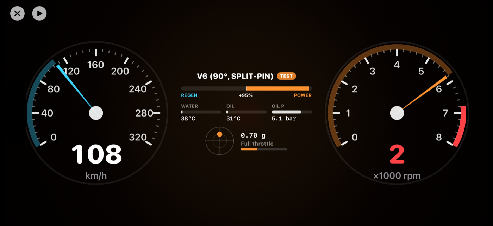

# Brumbrum

A synthetic engine sound for an EV. The iPhone reads the car's motion from its own sensors, invents an rpm and a load, synthesises an engine note in real time, and plays it over CarPlay mixed on top of whatever else is playing.

Built for an iPhone in an Audi S e-tron GT, but nothing in it is specific to that car.



## What's in it

- **Engines are data.** Each engine is a JSON file in `Brumbrum/Engines/`: firing angles, banks, gear ratios, exhaust resonances, engine orders, turbo and mix. Presets: Inline-4, Inline-4 Turbo, V6 (90°, split-pin), Crossplane V8, Flatplane V8, V10, V12 and a synthetic Futuristic voice. User engines are saved as the same JSON and can be imported and exported.
- **Real-time synthesiser** (`Brumbrum/Synth/`). A firing-angle pulse train drives per-bank exhaust resonators and a pipe-length comb filter, layered with engine-order sines and intake, wind and turbo noise. It runs in an `AVAudioSourceNode` callback with no allocation or locks. Control values arrive through a lock-free triple buffer.
- **Vehicle estimation** (`Brumbrum/Vehicle/`). CoreMotion at 100 Hz plus GPS, fused with a 1-D Kalman filter. The phone's mount orientation is calibrated, and the app fades out if the phone is knocked on its mount. A powertrain model invents rpm and load, with gears, launch slip, creep, shift events, idle wander and a rev limiter.
- **Latency compensation.** A sweep-and-microphone measurement is stored per audio route. The app then predicts the car's state up to 250 ms ahead to cover the delay.
- **Test drive.** Scripted scenarios (launch, cruise, kickdown, lift-off, hard braking, stop-and-go, full lap) and manual pedals, run through a simple model of the car. You can audition every engine without driving.
- **CarPlay dashboard.** Speedometer, rev counter, power/regen bar, temperatures, boost or oil pressure, and a g-meter. There are also compact views for CarPlay Dashboard and the instrument cluster.

## Building

Requires Xcode 26 and [XcodeGen](https://github.com/yonaskolb/XcodeGen). `Brumbrum.xcodeproj` is generated from `project.yml`; regenerate it after changing the project file:

```bash
xcodegen generate
```

Then open `Brumbrum.xcodeproj`, pick your team under Signing, and run.

### CarPlay

CarPlay only lets navigation-category apps draw their own screens, and that permission (`com.apple.developer.carplay-maps`) has to be granted by Apple. To keep phone builds signable in the meantime:

- **Simulator builds** always include the CarPlay entitlement (`Brumbrum/CarPlay.entitlements`). Use Simulator → I/O → External Displays → CarPlay.
- **Device builds** leave it out (`Brumbrum/Phone.entitlements`) until you set `ENABLE_CARPLAY` to `YES`. The phone app, sound and test drive all work without it; CarPlay just won't show the app.

Once Apple grants the entitlement (request it at [developer.apple.com/carplay](https://developer.apple.com/carplay/)), enable CarPlay Navigation on the app ID and set `ENABLE_CARPLAY: "YES"` in `project.yml`, or override `ENABLE_CARPLAY=YES` in Xcode's build settings.

Known issue: in the iOS 26.5 simulator, Apple's CarPlay host process crashes when any navigation app opens (`-[CPSTemplateInstance vehicleSupportsDestinationSharing]: unrecognized selector`). Until that's fixed, Settings → CarPlay → "Preview CarPlay gauges" renders the same dashboard on the phone.

## Offline render test

Renders every preset through a test-drive scenario to WAV files on the Mac and prints levels and CPU use:

```bash
Tools/render_test.sh lap /tmp/brumbrum-render
```

## Safety

The app never touches the car's exterior pedestrian warning sound (AVAS). The output level has a hard ceiling and a speed-dependent cap. A brickwall limiter sits before the output. Keep the level modest: a note loud enough to beat road noise can also mask sirens, horns and the car's own warnings.
